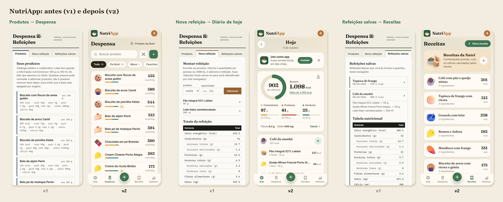
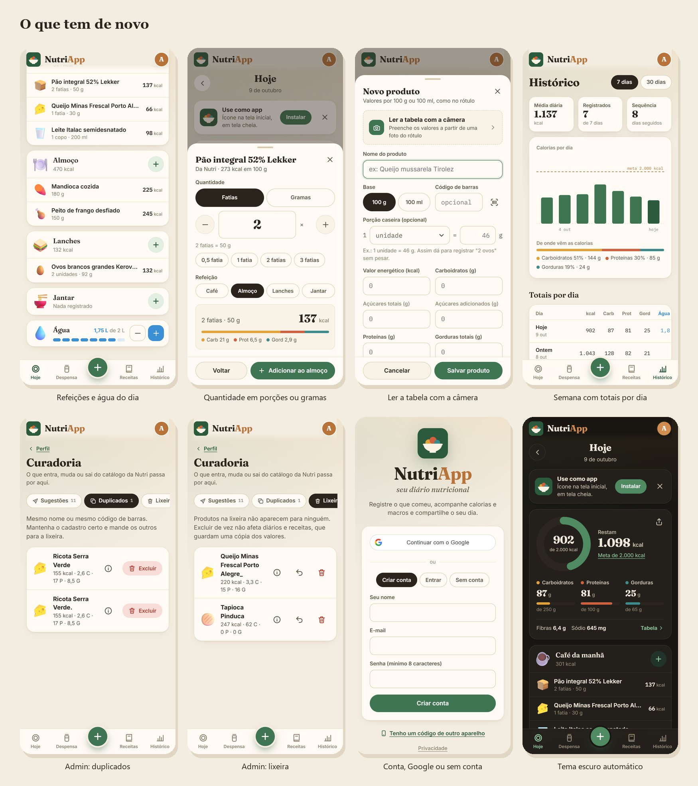

# NutriApp

Diário nutricional: registre o que comeu, acompanhe calorias, macros e água,
leia rótulos com a câmera e compartilhe o seu dia.

App: https://abentofilho.github.io/nutri_app/



## O que o app faz

- **Diário.** Café, almoço, lanches e jantar, com anel de calorias, macros em
  relação à meta, água e a tabela completa do dia com %VD. Guarda os últimos
  30 dias; os mais antigos saem sozinhos.
- **Porções.** Cada produto pode ter uma porção caseira ("1 unidade = 46 g",
  "1 fatia = 25 g"). Na hora de registrar, escolha "2 unidades" em vez de pesar.
- **Leitura de rótulos.** Fotografe a tabela nutricional e os campos do
  cadastro são preenchidos (modelo novo da ANVISA, com coluna de 100 g, e o
  antigo, só com a porção). A leitura roda no aparelho; a foto não é enviada.
- **Código de barras.** Lê pela câmera; o que não está no catálogo é buscado no
  [Open Food Facts](https://br.openfoodfacts.org).
- **Despensa.** Catálogo da Nutri (de todos) e produtos pessoais (só de quem
  cadastrou), com busca sem acento, favoritos e aviso quando o rótulo não fecha.
- **Receitas da Nutri** e receitas de cada pessoa, editáveis e registradas com um
  toque, em ½, 1, 1½ ou 2 porções.
- **Histórico.** Semana ou 30 dias: gráfico, média, sequência e a tabela de
  totais por dia, com download em planilha (CSV) ou PDF, e story da semana.
- **Sugestões e curadoria.** Qualquer pessoa sugere produtos ou correções; o
  administrador aprova, encontra duplicados e exclui produtos (lixeira com
  restaurar e excluir de vez).
- **Contas.** E-mail e senha, Google ou sem conta. Com conta, o diário é o mesmo
  no celular e no computador. Confirmação de e-mail, "esqueci minha senha",
  troca de senha e "sair dos outros aparelhos". Código/QR para levar a conta a
  outro aparelho.
- **App no celular.** Instalável no iPhone e no Android, com tema escuro
  automático.



## Como está organizado

```
index.html            casca da página
css/app.css           visual (tema claro e escuro)
js/
  app.js              rotas (#/hoje, #/despensa…) e início do app
  config.js           endereço do backend (troque aqui se mudar o servidor)
  api.js, store.js    conversa com o backend e estado do app
  nutrition.js        nutrientes, %VD da ANVISA e validação dos rótulos
  foods.js            ícone de cada alimento pelo nome
  label-reader.js     leitura da tabela nutricional pela câmera
  scanner.js          leitor de código de barras
  share.js            story, CSV e relatório
  ui.js               peças visuais (janelas, anel, tabela nutricional)
  views/              uma tela por arquivo
  sheets/             produto, seletor de alimentos, quantidade, receita
  pwa.js, sw.js       instalação no celular
  github.js           login do administrador pelo GitHub
  privacy.js          aviso de privacidade
privacidade.html      política de privacidade (página pública)
assets/food/          ícones de alimentos (Fluent Emoji, licença MIT)
backend/main.py       API (FastAPI + SQLAlchemy)
backend/tests/        testes (rodam no GitHub a cada push)
```

Não tem etapa de build: HTML, CSS e JavaScript publicados direto pelo GitHub Pages.

## Administrador

O administrador é quem entra com a conta do GitHub **abentofilho**. Não precisa
configurar nada no servidor:

1. Na tela de entrada, toque em **Continuar com o GitHub** (quem já tem conta no
   app usa **Perfil › Vincular GitHub**).
2. O app mostra um código. Toque no botão: ele copia o código e abre o GitHub.
   Cole o código e autorize.
3. Volte para o app. A Curadoria aparece no Perfil.

Digite no GitHub só um código que o próprio app mostrou na sua tela, nunca um
que alguém enviou.

O login usa um OAuth App do GitHub cujo Client ID (público) vem no código. Para
usar um OAuth App próprio, crie um em **Settings › Developer settings › OAuth
Apps** com **Enable Device Flow** marcado e coloque o Client ID em
`GITHUB_CLIENT_ID` no Render. Com `GITHUB_CLIENT_SECRET` também definido, o
login passa a ser por redirecionamento, sem código.

## Rodando na sua máquina

```bash
cd backend
pip install -r requirements.txt
uvicorn main:app --reload --port 8000
```

Em outro terminal, na raiz do projeto:

```bash
python -m http.server 5500
```

Abra http://localhost:5500. Em `localhost`, o front usa o backend local
automaticamente (SQLite, arquivo `backend/nutri.db`).

Testes:

```bash
cd backend
pip install -r requirements-dev.txt
pytest
```

## Variáveis de ambiente (Render)

| Variável | Para quê |
|---|---|
| `DATABASE_URL` | O Postgres (já configurado). |
| `GITHUB_CLIENT_ID` | Opcional. Troca o OAuth App do login com GitHub (o padrão vem no código). |
| `GITHUB_CLIENT_SECRET` | Opcional. Troca o login por código pelo redirecionamento. |
| `ADMIN_GITHUB` | Contas do GitHub administradoras. Padrão: `abentofilho`. |
| `ADMIN_EMAILS` | Opcional. E-mails administradores; só valem se confirmados pelo Google ou GitHub. |
| `GOOGLE_CLIENT_ID` | Opcional. Troca o cliente OAuth do login com Google (o padrão vem no código). |
| `BREVO_API_KEY` (ou `RESEND_API_KEY`), `MAIL_FROM` | Opcional. Liga os e-mails de confirmação e de nova senha. |
| `CORS_ORIGINS` | Sites que podem usar a API. Padrão: o GitHub Pages do app e `localhost`. |
| `HISTORY_DAYS` | Dias guardados no diário. Padrão: 30. |

### Login com Google

Já vem ligado: o ID do cliente OAuth (público) está no código. Para usar um
cliente próprio:

1. Em https://console.cloud.google.com: **Google Auth Platform › Clientes ›
   Criar cliente** (aplicativo da Web).
2. Em **Origens JavaScript autorizadas**, adicione `https://abentofilho.github.io`.
3. Copie o ID do cliente para `GOOGLE_CLIENT_ID` no Render.

### E-mails: confirmação de conta e "esqueci minha senha"

Sem configurar nada, o app funciona; só não aparecem "Esqueci minha senha" e a
confirmação de e-mail. O Render gratuito bloqueia SMTP, então o envio usa a API
de um provedor. Com o [Brevo](https://www.brevo.com) (300 e-mails por dia no
plano gratuito, sem precisar de domínio próprio):

1. Crie a conta no Brevo e confirme o e-mail que vai aparecer como remetente
   (em **Senders**).
2. Gere uma chave em **SMTP & API › API Keys**.
3. No Render, crie `BREVO_API_KEY` com a chave e `MAIL_FROM` com o remetente,
   por exemplo `NutriApp <seuemail@gmail.com>`.

Com domínio próprio, o [Resend](https://resend.com) também serve: use
`RESEND_API_KEY` no lugar de `BREVO_API_KEY`. Para testar na sua máquina sem
enviar nada, defina `MAIL_FILE=emails.jsonl`: os e-mails são gravados no arquivo.

## Segurança e privacidade

- Senhas com PBKDF2-SHA256 (390 mil iterações); sessões guardadas como hash.
  Senhas óbvias ("12345678", o próprio e-mail) são recusadas.
- Limite de tentativas de login, de criação de contas, de códigos de
  transferência e de pedidos de e-mail.
- Links de e-mail valem uma vez só (30 minutos para nova senha), são guardados
  como hash e só apontam para o endereço do app. O pedido de nova senha responde
  igual exista a conta ou não. Trocar ou redefinir a senha desconecta os outros
  aparelhos.
- Um e-mail só conta como confirmado pelo link enviado, pelo Google ou pelo
  GitHub; sem isso, nunca dá acesso de administrador. Se o dono do e-mail
  entrar depois pelo Google ou GitHub, a conta passa a ser dele e a senha
  cadastrada por outra pessoa deixa de valer.
- A API só aceita chamadas do site do app (CORS) e responde com cabeçalhos de
  segurança. O site tem Content Security Policy e as bibliotecas externas são
  conferidas por hash (SRI).
- Fotos de rótulos e códigos de barras são lidos no próprio aparelho.
- Aviso de privacidade (LGPD) na entrada e no Perfil; excluir a conta apaga os
  dados e tira o nome das sugestões já aprovadas.

## Atualização da v1 para a v2

Ao subir, o backend migra o banco sozinho, sem apagar nada:

- cria as tabelas novas e adiciona as colunas e índices novos;
- corrige erros de digitação do catálogo, só se o valor ainda for o errado:
  proteína do Queijo Minas Frescal Porto Alegre (1515 → 15 g; a cópia
  "Porto Alegre_" vai para a lixeira), carboidrato da Sardinha Coqueiro
  (441,4 → 0 g), a Tapioca Pinduca duplicada (lixeira) e os nomes Cream Cheese
  e Leitíssimo;
- cria as Receitas da Nutri e as porções de alguns produtos (ovo, pão,
  queijos, leites).

As refeições salvas na v1 ficavam presas ao navegador. Na primeira vez que a
pessoa entra na v2 pelo mesmo navegador, elas passam para a conta dela, em
Minhas receitas; a partir daí, valem em qualquer aparelho em que ela entrar.

## Créditos

Ícones de alimentos: [Fluent Emoji](https://github.com/microsoft/fluentui-emoji),
da Microsoft, licença MIT (veja `assets/food/LICENSE.txt`). Leitura de rótulos
com [Tesseract.js](https://github.com/naptha/tesseract.js) (Apache 2.0).
